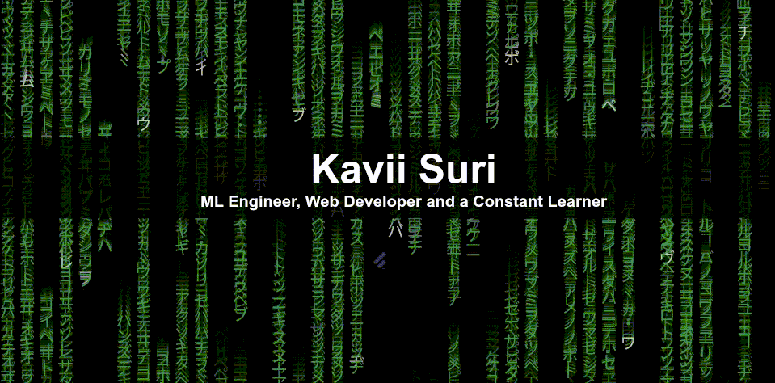

# Hi, I'm Kavii 👋

📍 **Gurugram** | 🎬 **AI media, end to end** | 📦 **Can't be put in a box**

**I'm the engineer you throw at a business problem.** Frontend, backend, data, ML or infra. I figure it out.

Now at **[CAMB.AI](https://camb.ai)**, building lip-sync and dubbing agents. Before that, first engineer on **Speechify Studio**.

## 👀 Says who?

- 👄 **Multi-speaker lip-sync** (~$800K in 3 months). I invented it, end to end
- 🎞️ **Speechify Studio** ($4M ARR in year one). First engineer, GPU transcoder to frontend
- 🎧 **Agentic dubbing** (turnaround halved). An agent that listens to its own work

> **Got a problem like that?** [surikavii@gmail.com](mailto:surikavii@gmail.com) · [X](https://x.com/kavii_suri) · [kaviisuri.com](https://kaviisuri.com)

## 🎬 CAMB.AI, 2026 to now

### Lip-sync

- 🕵️ **Person tracking.** Finds everyone on screen and syncs the right one
- 🎛️ **Lip-sync studio.** Takes, approvals, renders, export. R&D to production in a month
- ⏳ **Non-blocking editor.** Keep editing while a shot generates
- 🖥️ **Media compute.** Kubernetes with GPU encoding
- 🐢 **Stitching.** Removed a quadratic decode
- 🎨 **Frame accuracy.** No colour seams, no dropped frames
- 📝 **Reviewer tooling.** Comments, severities, a delivery-blockers page

### Dubbing agents

- 👂 **The director.** Translates, generates, then listens to its own dub
- 🎭 **Voice casting.** Auditions voices in the target language
- ⏱️ **Retiming.** Keeps the original's pace and overlaps
- 🗣️ **Pronunciation.** Fixes names with IPA, across 163 languages
- 🔁 **Durable runs.** Cloudflare Workflows that survive a deploy
- 💸 **Billing.** Usage billing and cost per agent

### Everything else

- 🧪 **QA from state machines.** Tests derived from flow diagrams. 0 to 65% coverage
- 📟 **On-call handoffs.** Automated with agents
- 📚 **Audiobook QC and export.** Five services, Audible/ACX checks
- 🧱 **Portal architecture.** Business logic out of React, into services
- 🖼️ **Image translation.** Indic scripts that render correctly
- 🌊 **Streaming text-to-speech.** LLM tokens in, audio out
- 📖 **Docs and SDKs.** Eight languages
- 🏆 **Dubbing Squad hackathon.** Won it

## 🎙️ Speechify, 2023 to 2026

### Studio

- 🥇 **First engineer.** An AI video editor in the browser, from zero
- ⚙️ **Backend.** Orchestration for AI video, and the first job queue
- 🧬 **Voice cloning.** A dub keeps the speaker's own voice
- 🌍 **AI pipelines.** Speech, transcription, translation
- 🧑‍🎤 **AI avatars** and real-time preview
- 🎞️ **The transcoder.** A timeline in, video out, on GPUs. 40% cheaper compute
- ✂️ **The editor.** Timeline and WYSIWYG canvas
- ⚡ **Voiceover rewrite.** Led it, on signals

### Platform

- 💳 **Payments and entitlements**
- 📊 **Voice model analytics** on ClickHouse
- 🚚 **Voice sample delivery** with Redis caching
- 🎙️ **AI podcasts.** Rebuilt the pipeline with RAG
- 🗄️ **Data engineering** for text-to-speech training
- 🧠 **AI serving.** Voice design tools and model hosting

## 🚪 Before that

- ⚡ **Procol.** Live auctions from 30 s to under 100 ms
- 🔍 **Sherlog.** A test runner that needs no written tests
- 🤝 **Vendor matching** and auction platform v2
- ♟️ **Black Marbles Tech.** A freelancing group I started in college
- 🇦🇹 **Regioheld.** Search for Austrian regional shops
- 📜 **Contract system.** Customizes expert-written legal documents
- 🎓 **NIT Silchar.** Taught ML. Three hackathon wins
- 🚶 I got my first internship by [walking into the office uninvited](https://kaviisuri.com/how-i-got-my-first-internship-by-crashing-their-office)

## 🚀 Products I've built

- 🧠 **Notely** (~100 weekly active users). A second brain for your conversations
- 🎨 **Fray** (200 on the waitlist). An AI co-designer inside Figma
- 📈 **Vizard.** Ask your customer feedback a question, get charts. Never got customers 😅

## 🛠️ Tools I've built

### Plugins for [bb](https://getbb.app), the agentic IDE I work in

- 📥 **[inbox](https://github.com/KaviiSuri/bb-plugin-inbox).** A fork of bb's thread list, with an inbox of what agents need from you
- 🎯 **[goal](https://github.com/KaviiSuri/bb-plugin-goal).** An objective that only completes with evidence
- 🧭 **[px0 plugin](https://github.com/KaviiSuri/bb-plugin-px0).** Embeds the px0 code navigator in a bb thread
- 🌳 **[worktree-setup](https://github.com/KaviiSuri/bb-plugin-worktree-setup).** Worktrees that arrive ready to run
- 🕸️ **[tasks](https://github.com/KaviiSuri/bb-plugin-tasks).** bb's Tasks plugin, plus subtasks and a graph

### Agent tools

- 🧠 **[sanj](https://github.com/KaviiSuri/sanj).** Your coding sessions, turned into agent memory
- 🔁 **[ralphctl](https://github.com/KaviiSuri/ralphctl).** An inspectable agent loop for OpenCode
- 🤖 **Maya.** A Discord bot for OpenCode. Agents on my laptop, from my phone

### For me

- 🔎 **[peek](https://github.com/KaviiSuri/peek).** <kbd>Ctrl</kbd> + <kbd>Space</kbd>, type, <kbd>Enter</kbd>. Tab switched
- 🫥 **[poof](https://github.com/KaviiSuri/poof).** Hides words you don't want on your screen

### To understand how things work

- 📱 **[qrious](https://github.com/KaviiSuri/qrious).** A QR decoder in Rust
- 🖥️ **[bm](https://github.com/KaviiSuri/bm).** A virtual machine with its own assembly
- 🐒 **[monkey-lang](https://github.com/KaviiSuri/monkey-lang).** An interpreter in Go
- 🃏 **[pokergg](https://github.com/KaviiSuri/pokergg).** Distributed poker in Go

## 🧩 Open source

- 🎲 **DiceDB.** [`GEOADD` and `GEODIST`](https://github.com/dicedb/dicedb/pull/947), [`GETRANGE`](https://github.com/dicedb/dicedb/pull/679), logging, the playground monorepo
- 🔧 **nx, ToolJet, notify.** Smaller fixes

## ✍️ Writing

- [AI changes what's worth automating](https://kaviisuri.com/ai-changes-what-s-worth-automating)
- [Your AI is editing your prompt behind your back](https://kaviisuri.com/your-ai-is-editing-your-prompt-behind-your-back)

## Connect

🦇 The first commit in every repo I start is called `batman`. The gif is generated, and [here's the code](https://github.com/KaviiSuri/matrixgif).
